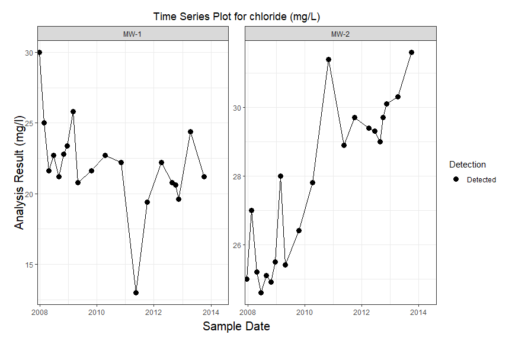
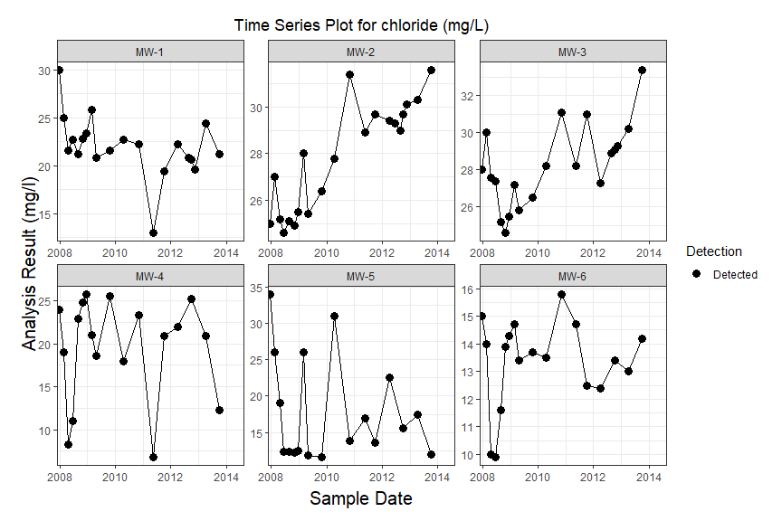
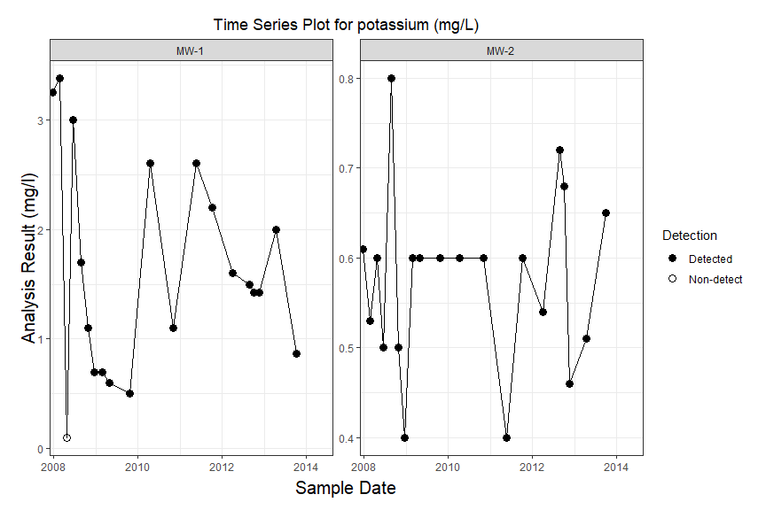
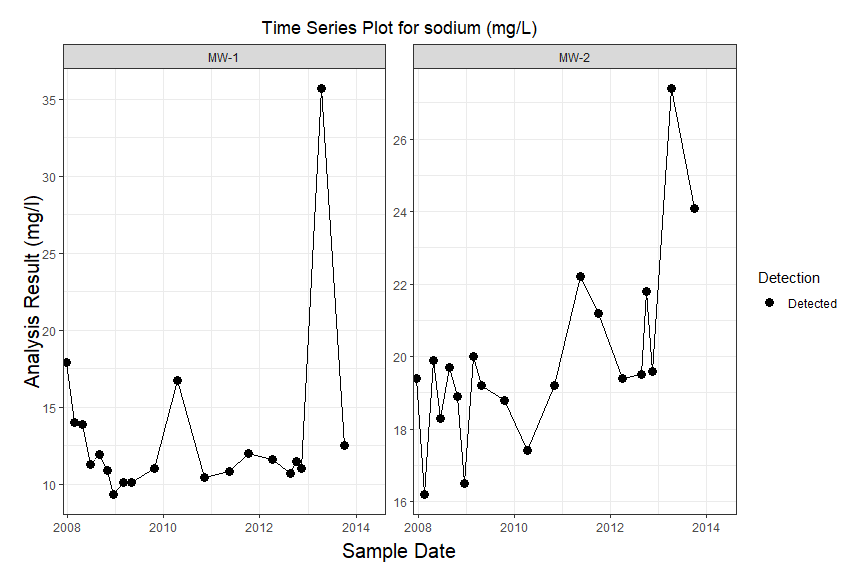
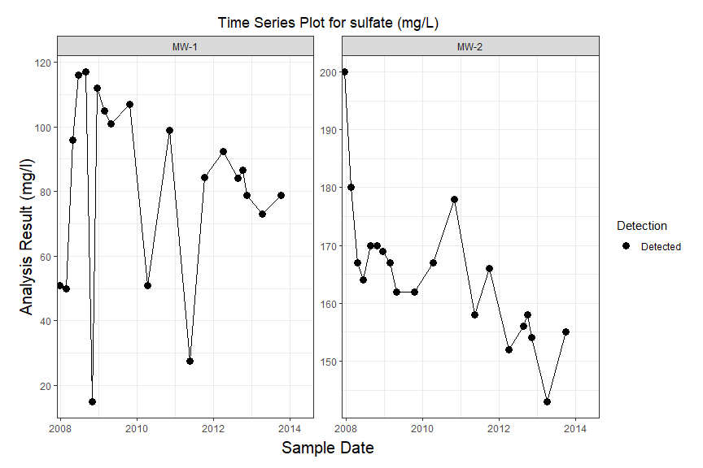
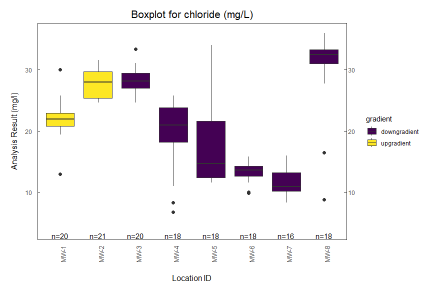
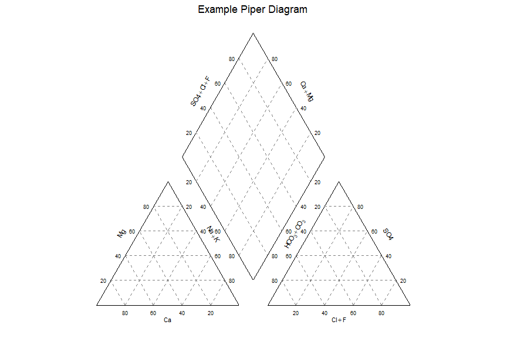

## Overview

`manager` provides a standardized workflow for environmental data
analysis in R.

The package centers around the `env_schema` class, a standardized
environmental data model built on top of tidy data principles. Once data
have been converted to `env_schema`, they can be analyzed, summarized,
visualized, and reported using a consistent workflow.

Key features include:

- Standardized environmental data structure (`env_schema`)
- Native compatibility with dplyr and the tidyverse
- Time-series, boxplot, Piper, and spatial visualizations
- Summary statistics and reporting utilities
- Importers for MANAGES databases

## Why manager?

Environmental datasets are often distributed across spreadsheets,
laboratory reports, groundwater databases, and regulatory exports.
`manager` provides a common data model(`env_schema`) that allows the
same analysis and plotting tools to work across data sources without
rewriting workflows for each project.

## Installation

Install the development version from GitHub:

``` r

install.packages("remotes")

remotes::install_github("jentjr/manager")
```

## Quick Start

``` r

library(dplyr)
#> 
#> Attaching package: 'dplyr'
#> The following objects are masked from 'package:stats':
#> 
#>     filter, lag
#> The following objects are masked from 'package:base':
#> 
#>     intersect, setdiff, setequal, union
library(manager)

data(gw)

gw %>%
  filter(location_id == "MW-1",
         .analyte == "Chloride") %>%
  stats_summary()
#> # A tibble: 1 × 16
#>   location_id param_name      .analysis_unit     n percent_censored  mean median
#>   <chr>       <chr>           <chr>          <int>            <dbl> <dbl>  <dbl>
#> 1 MW-1        Chloride, total mg/l              20                0  22.0   21.9
#> # ℹ 9 more variables: sd <dbl>, var <dbl>, min <dbl>, max <dbl>, cv <dbl>,
#> #   `25%` <dbl>, `75%` <dbl>, IQR <dbl>, mad <dbl>
```

## Environmental Data Standard

Datasets in `manager` use the `env_schema` class:

``` r

gw
#> <env_schema>
#> 5878 rows x 41 columns
#> Locations: 8 
#> Analytes: 49 
#> Valid: TRUE 
#> Version: 0.5.0
```

Output:

``` R
12345 rows × 15 columns
Locations: 48
Analytes: 72
Date range: 2015-01-01 to 2024-12-31
Class: env_schema
```

Core environmental variables include:

- location
- analyte
- result
- date

Additional metadata such as units, qualifiers, detection limits,
coordinates, sample identifiers, and analytical methods can also be
stored and preserved by the schema.

## Import Data

``` r

gw <- read_manages3("Site.mdb")

gw <- read_manages4(
  server = "MY_MANAGES_SERVER",
  database = "MY_MANAGES_DATABASE",
  site = "MY_SITE"
)
```

## Visualize Data

``` r

# load example data and plot time series of selected wells and constituents
data("gw")

wells <- c("MW-1", "MW-2")

params <- c("Magnesium, dissolved", 
            "Sodium, dissolved", 
            "Chloride, total", 
            "Sulfate, total", 
            "Potassium, dissolved")

gw %>%
  filter(location_id %in% wells, param_name %in% params) %>%
  series_plot()
```



``` r

# create boxplots filled by gradient
gw %>%
  filter(param_name == "Chloride, total", 
         location_id %in% c("MW-1", "MW-2", "MW-3", "MW-4", "MW-5", "MW-6", "MW-7", "MW-8")) %>%
  mutate(gradient = if_else(location_id %in% wells, "upgradient", "downgradient")) %>% 
  boxplot(fill = "gradient")
```



Piper Diagrams and more…

``` r

gw %>%
  piper_plot()
```



## Interactive Exploration

manager also includes a Shiny application:

``` r

manager::manager()
```
